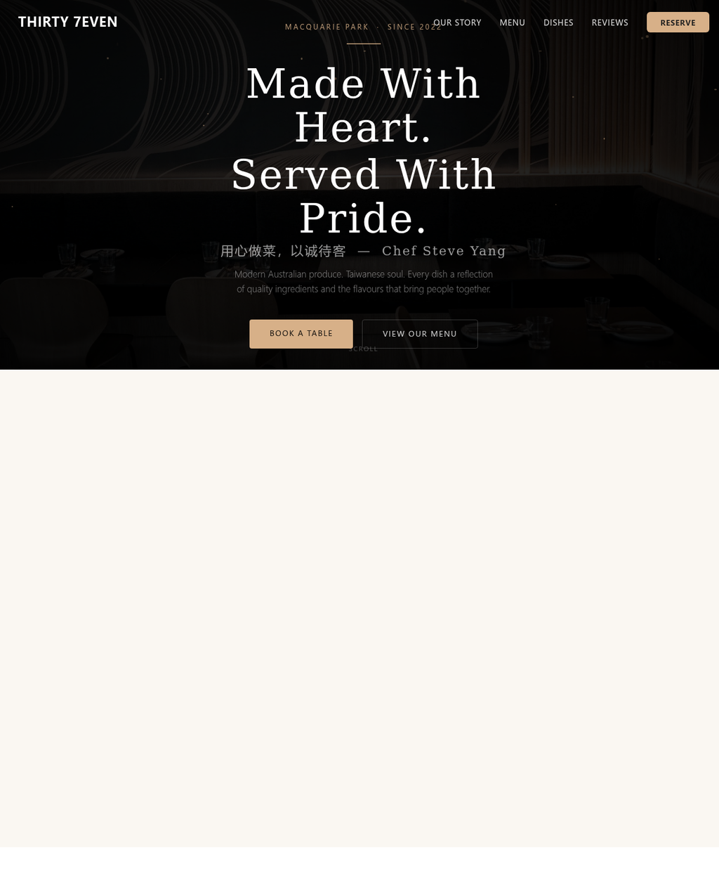

# Thirty 7even Dining — Restaurant Website

A single-file website for **Thirty 7even**, a modern Australian × Taiwanese restaurant in Macquarie Park, Sydney (Chef Steve Yang).

**Live:** https://12345666ddwa.github.io/thirty7even/ — or open `index.html` in any browser.

## About this build

- **Single-file `index.html`** — no build step, no dependencies; deploy anywhere (GitHub Pages, any static host).
- Full restaurant site: hero, story, signature dishes, filterable menu (small plates / mains / noodles & rice / drinks / desserts), reviews, reservation form, hours & location.
- Built around the restaurant's own photography and real menu, with a warm, editorial visual language.

Design & build: Xing Gao — part of a **restaurant website portfolio**.

## Notes

Photography, brand and menu belong to Thirty 7even; shown here as part of the portfolio preview.
